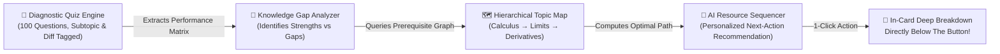

# 🎓 Smart Study Hub | Hackathon 2026 Showcase

[](https://github.com)
[](https://github.com)
[](https://github.com)
[](https://github.com)
[](https://github.com)
[](https://github.com)
[](LICENSE)

> **Elevator Pitch:** *Smart Study Hub is a lightweight, zero-dependency academic platform and AI-driven Personalized Learning Resource Sequencer. It eliminates learner inertia by diagnosing demonstrated strengths and knowledge gaps from practice sessions, recommending optimal next-topic study pathways through interactive prerequisite knowledge maps, and delivering 100 curated benchmarks across Mathematics, Chemistry, Physics, and English in 3 languages (English, தமிழ், हिन्दी) with 150 inspiring motivational quotes.*

---

## 🌐 Live Demo & Instant Preview
* **Live Deployment:** `https://<your-username>.github.io/<your-repository-name>/`
* **Local Run:** Open `index.html` directly in any web browser (Chrome, Edge, Firefox, Safari) — **no installations, build steps, or servers required!**
* **Presentation Deck:** Included as `smart_study_hub_hackathon_pitch.pptx` (along with generator `generate_hackathon_deck.py`).

---

## 🤖 AI & Intelligent Automation Track: Personalized Resource Sequencer

### The Problem: Post-Assessment Learner Inertia
Learners often feel lost after completing a quiz or study sprint. Traditional learning portals simply return a flat percentage score (*"You scored 65%"*) without providing an actionable, personalized roadmap of what concept or resource to tackle next.

### Our Solution: 3-Pillar Autonomous Sequencing Architecture


1. **Granular Diagnostic Extraction**: Every question is tagged by subtopic and difficulty tier (`Easy`, `Medium`, `Hard`). When questions are answered, the engine pinpoints specific conceptual boundaries (e.g., student understands Power Rule, but has an active gap in Trigonometric Limits).
2. **Topological Prerequisite Graph**: The Huge Mind Map Studio acts as a directed knowledge graph connecting foundational axioms to advanced analytical systems.
3. **Adaptive Recommendation Logic**:
   * **Gap Detected ($\le 70\%$ accuracy)**: Sequencer triggers remediation, recommending the exact foundational Deep Breakdown directly under the topic card.
   * **Mastery Demonstrated ($\ge 70\%$ accuracy)**: Sequencer advances the student directly to Hard Tier sprints or next curriculum modules.

---

## ⚡ Core Feature Matrix

| Feature | Description | Engineering Highlights |
| :--- | :--- | :--- |
| **📖 In-Card Deep Breakdown Drawers** | Unfolds directly beneath the clicked button inside the subject card. | Zero jarring page scroll or layout jump; includes theory, formulas, industrial apps, and motivation dialogue. Maximize modal option included. |
| **🌐 Full-Page Localization (Every Nook & Corner)** | 100% dynamic translation across English, தமிழ் (Tamil), and हिन्दी (Hindi). | Updates all card subtopics, level tags, badges, buttons, theory studio, mind maps, quizzes, timer presets, and AI sequencer. |
| **🌟 150 Motivational Quotes (50 per Language)** | Exactly 50 quotes in English, 50 in Tamil, and 50 in Hindi. | StudyBot cheers with random quotes, celebratory confetti, and Web Audio synthesizers. Features a dedicated 50 Quotes Gallery Modal! |
| **🤖 AI Resource Sequencer** | Autonomous next-topic recommendation based on live quiz diagnostics. | Evaluates demonstrated strengths vs knowledge gaps; prescribes exact 1-click study actions. |
| **🎯 100 Academic Benchmarks** | Exactly 25 questions per subject (Math, Chem, Phys, Eng) across 3 tiers. | Categorized into Easy (8), Medium (9), Hard (8) with instant academic explanations & confetti cheers. |
| **⏱️ Dual Time Tracker** | Active count-up Stopwatch + Countdown Focus Sprint Timer (25m / 15m / 45m). | Non-blocking dual time engine with audible focus completion alarms and session summary modals. |
| **🧠 Huge Subject Mind Maps** | Expansive interactive knowledge topologies for every subject module. | Clickable concept nodes with live deep-dive inspector and student motivation dialogue. |
| **⭕ Progress Accuracy Wheel** | Circular vector graphic progress wheel updating in real-time per subject. | Hardware-accelerated SVG `stroke-dashoffset` transition with live percentage and rank indicators. |
| **🖱️ Glitch-Free Custom Aura** | Smooth magnetic cybernetic ring and cyan dot with tactile mobile ripples. | Native pointer stays 100% responsive (`cursor: default`); GPU `translate3d` tracking. |

---

## 📐 Curriculum Architecture (4 Core Modules • 25 Questions Each)

```
Smart Study Hub
 ├── 📐 Mathematics (25 Qs: 8 Easy, 9 Medium, 8 Hard)
 │    ├── Calculus: Limits & Continuity, Tangent Slopes, Derivations, Optimization
 │    └── Matrices: Operations, Determinants (ad - bc), Invertibility, Cramer's Rule
 ├── 🧪 Chemistry (25 Qs: 8 Easy, 9 Medium, 8 Hard)
 │    ├── Organic Chemistry: Alkanes, Alkenes, Alkynes, Hybridization (sp³/sp²/sp), Benzene
 │    └── Periodic Table & Bonding: Electronegativity Trends, Ionic Lattices, Covalent Sharing, H-Bonds
 ├── ⚛️ Physics (25 Qs: 8 Easy, 9 Medium, 8 Hard)
 │    ├── Classical Mechanics: Rectilinear Kinematics, Galileo Equations, V-T Graph Calculus, Free Fall
 │    └── Electromagnetism: Magnetic Flux (Webers), Faraday Induction, Lenz's Law, Transformers & Eddy Currents
 └── 📖 English (25 Qs: 8 Easy, 9 Medium, 8 Hard)
      ├── Grammar & Syntax: Clause Hierarchy (Independent vs Dependent), Tenses, Semicolons, Voice
      └── Literature & Poetics: Shakespearean Sonnet 18, Iambic Pentameter Scansion, Conceits, Figures of Speech
```

---

## 📁 Repository Structure

```
smart-study-hub/
 ├── index.html                               # Complete zero-dependency web application & AI sequencer
 ├── README.md                                # Comprehensive documentation & project architecture
 ├── smart_study_hub_hackathon_pitch.pptx     # Hackathon pitch deck presentation slides
 └── generate_hackathon_deck.py              # Automated Python script to generate the pitch deck
```

---

## 🚀 How to Publish to GitHub & Host Live

### Fast Method: GitHub Web Interface (2 Minutes)
1. Go to [GitHub.com](https://github.com) and click **"New repository"**.
2. Name it `smart-study-hub`, make it **Public**, and click **"Create repository"**.
3. Click **"Add file"** $\rightarrow$ **"Upload files"**.
4. Drag and drop all files from your `smart-study-hub` folder:
   * `index.html`
   * `README.md`
   * `smart_study_hub_hackathon_pitch.pptx`
   * `generate_hackathon_deck.py`
5. Click **"Commit changes"**.

### Activate Free Hosting with GitHub Pages:
1. In your repository, go to **Settings** $\rightarrow$ **Pages** (in the left sidebar).
2. Under **"Branch"**, select `main` (or `master`) and folder `/(root)`, then click **Save**.
3. In under 1 minute, your website will be live at:
   ```
   https://<your-username>.github.io/smart-study-hub/
   ```

---

## 👥 Hackathon Team & Credits
* **Project:** Smart Study Hub
* **Track:** AI & Intelligent Automation | Personalized Learning Resource Sequencer
* **Built With:** Pure HTML5, CSS3, ES6+ JavaScript, Python (Zero External Dependencies)
